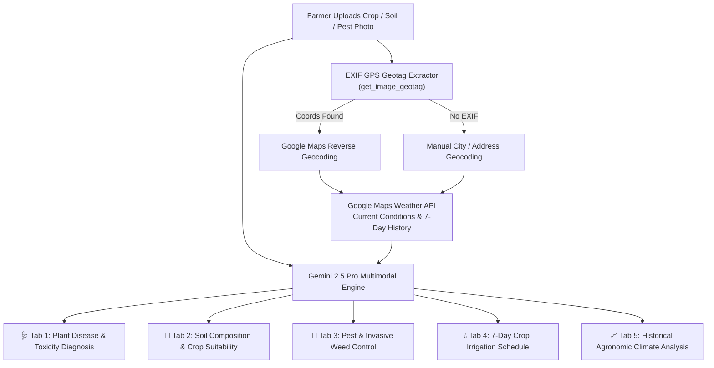

# 🧑‍🌾 AgriTech Crop & Weather Copilot (`agritech-crop-weather-copilot`)


**AgriTech Crop & Weather Copilot** is a multimodal precision-agriculture decision-support system built with **Streamlit**, **Google Gemini 2.5 Pro**, **Google Maps Geocoding API**, and the **Google Maps Platform Weather API**. It fuses computer vision on crop/soil/pest photography with real-time and 7-day historical hyper-local weather telemetry extracted from image EXIF GPS tags.

---

## 📐 System Architecture



---

## 📁 Project Structure

```text
agritech-crop-weather-copilot/
├── main.py                      # Primary application entry point
├── app.py                       # Streamlit entry point alias
├── feature_plant_diagnosis.py   # Multimodal Gemini, EXIF GPS, and Weather API implementation
├── requirements.txt             # Python dependencies
├── .env.example                 # Environment variable template
├── .streamlit/
│   └── secrets.toml.example     # Streamlit secrets template
└── README.md                    # Project documentation
```

---

## ⚙️ Configuration & Secrets

You can provide your API keys via either `.env` or `.streamlit/secrets.toml`:

| Key | Required | Description |
| :--- | :---: | :--- |
| `GEMINI_API_KEY` | Yes | Google Gemini API key for multimodal diagnosis (`gemini-2.5-pro`) |
| `GOOGLE_MAPS_API_KEY` | Yes | Google Maps Platform key with Geocoding API and Weather API enabled |

---

## 🚀 Quickstart

```bash
git clone https://github.com/shubhamv3129/agritech-crop-weather-copilot.git
   cd agritech-crop-weather-copilot
python3 -m venv .venv
source .venv/bin/activate
pip install -r requirements.txt

cp .env.example .env
# Or: cp .streamlit/secrets.toml.example .streamlit/secrets.toml
# Add your GEMINI_API_KEY and GOOGLE_MAPS_API_KEY

streamlit run main.py
```
